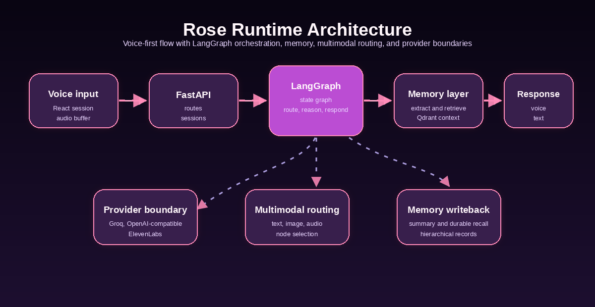
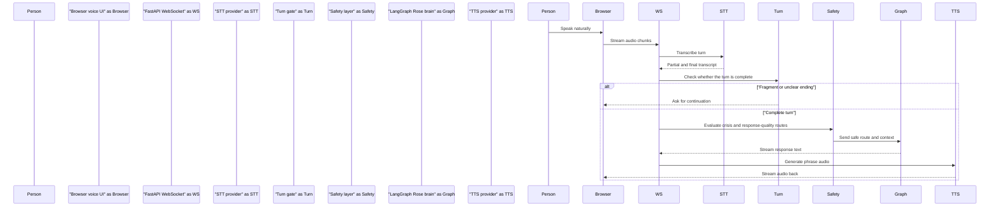

# Rose

<p align="center">
  <a href="https://github.com/Alexi5000/Rose">
    
  </a>
</p>

<p align="center">
  <strong>Voice-first AI emotional support for calm, reflective, and consent-aware conversations.</strong>
</p>

<p align="center">
  <a href="https://github.com/Alexi5000/Rose/actions/workflows/ci.yml"></a>
  <a href="https://github.com/Alexi5000/Rose/releases/latest"></a>
  <a href="LICENSE"></a>
  
  
</p>

<p align="center">
  <a href="#why-this-fork-exists">Why this fork exists</a> |
  <a href="#safety-boundary">Safety</a> |
  <a href="#architecture">Architecture</a> |
  <a href="#quick-start">Quick Start</a> |
  <a href="#documentation">Docs</a> |
  <a href="#upstream">Upstream</a>
</p>

## Why this fork exists

**What it does.** Rose is an open-source voice companion for emotional support, grounding, and reflective conversations. She combines a React and FastAPI voice interface, LangGraph orchestration, configurable AI providers (Groq, OpenRouter, Deepgram, ElevenLabs), Qdrant long-term memory with session-only, export, and forget controls, and deterministic crisis-safety routing that runs locally before any model call.

**Who it serves.** People who want a calm, consent-aware voice conversation in the browser, and the developers or operators who run such a companion and need provider fallbacks, memory privacy controls, and safety rules that keep working when an external model provider fails. Rose is AI emotional support. She is not a therapist, doctor, emergency service, or replacement for professional care. She can support reflection, grounding, spiritual language by consent, and continuity across sessions, but she must stay honest that she is AI and must route crisis language toward human help.

**Why Alex forked it.** Alex Cinovoj, Founder & CTO of TechTide AI, forked [neural-maze/ava-whatsapp-agent-course](https://github.com/neural-maze/ava-whatsapp-agent-course) on 2025-10-20 (GitHub API `created_at`). The first fork-only commit (`68a6b6d`, 2026-05-17: "Restore Rose v2 buildout on upstream main") states the intent: it "replays the recovered Rose v2 product README, contributor credits, release documentation, quality gates, assets, and upstream-compatible ElevenLabs SDK merge on top of the latest original upstream state". The fork moves the companion from the upstream WhatsApp channel to a browser voice loop; `src/ai_companion/settings.py` marks WhatsApp and image generation as frozen features, and [TECHTIDE.md](TECHTIDE.md) (commit `9902fe0`, 2026-07-07) records that TechTide uses Rose as a reference implementation for voice-first AI companions in healthcare-adjacent verticals. The 2026-10-18 to 2026-10-20 commits (#2 to #7) are security hardening: patched dependency APIs, exact allowed-origin checks, and administrator credentials on memory and monitoring routes.

**Real-world use case (2025–2026 evidence).** **Verified in this repository.** A person opens the browser voice UI, speaks, and Rose answers by voice. If a turn contains U.S. crisis language, the deterministic local safety layer surfaces 988 and human help before any model generates text; memory stays session-only unless the person opts in, and raw transcripts stay out of logs. This loop is exercised by `tests/unit/test_crisis_safety.py` (12 tests), `tests/unit/test_voice_websocket.py` (22 tests), and `tests/unit/test_privacy_logging.py` (20 tests), which run in `.github/workflows/ci.yml` (latest `main` run 2026-10-20: success). External context: the FTC opened a 6(b) study of consumer-facing AI companion chatbots in September 2025, asking operators how they test for and mitigate harm and disclose risks, which is the bar Rose's safety boundary and privacy defaults are written against[^1]. WhatsApp's Business API terms bar AI assistants whose primary function is the AI itself from 2026-01-15, so a self-hosted browser voice loop rather than the upstream WhatsApp channel is the surface Rose ships today[^2]. ElevenLabs' Conversational AI 2.0 release documents the real-time turn-taking and interruption handling that voice agents now need, which Rose implements in its turn gate and WebSocket route[^3]. LangGraph reached 1.0 in October 2025 and is the orchestration runtime Rose pins (`langgraph==1.2.16` in `pyproject.toml`)[^4].

## What Rose Does

| Capability | Current implementation |
| --- | --- |
| Voice sessions | Browser microphone, WebSocket audio turns, interruption handling, and voice timing metrics. |
| LLM routing | Groq by default, OpenRouter as primary or fallback through an OpenAI-compatible API. |
| Speech to text | Groq Whisper batch transcription by default, Deepgram streaming STT as an optional low-latency provider. |
| Text to speech | ElevenLabs server-side voice, plus explicit text-only/browser speech degraded modes. |
| Memory | Qdrant-backed long-term memory with session-only, export, and forget controls. |
| Safety | Deterministic local crisis routing, false-positive recovery, and response-quality checks before normal generation. |
| Contributor flow | Focused tests, provider interfaces, docs, and upstream Ava lineage notes for professional PRs. |

## Safety Boundary

Rose is built for warmth without pretending to be clinical care. Safety rules are local and deterministic so they still work when external model providers fail.

- U.S. crisis language surfaces 988 and encourages immediate human help.
- Imminent external danger routes to emergency-services, safer-place, and trusted-contact guidance without self-harm wording.
- Rose avoids diagnosis, emergency replacement, therapy replacement, cultural authority claims, and unhealthy dependency pressure.
- Spiritual or ritual language must be opt-in and consent-aware.
- Logs default away from raw transcripts, memory text, audio paths, provider payloads, and secrets.

## Architecture

<p align="center">
  <a href="docs/VOICE_ARCHITECTURE.md">
    
  </a>
</p>



```mermaid
flowchart LR
    "Voice route" --> "STT provider"
    "Voice route" --> "Turn detection"
    "Turn detection" --> "Safety provider"
    "Safety provider" --> "LangGraph workflow"
    "LangGraph workflow" --> "LLM provider"
    "LangGraph workflow" --> "Memory provider"
    "LLM provider" --> "Groq default"
    "LLM provider" --> "OpenRouter fallback"
    "Memory provider" --> "Qdrant long-term memory"
    "Voice route" --> "TTS provider"
    "TTS provider" --> "ElevenLabs"
    "TTS provider" --> "text-only/browser speech degraded modes"
```

## Quick Start

```bash
git clone https://github.com/Alexi5000/Rose.git
cd Rose
cp .env.example .env
uv sync --extra test --extra streaming-stt
cd frontend
npm ci
cd ..
```

Add provider keys to `.env`.

```bash
GROQ_API_KEY="..."
ELEVENLABS_API_KEY="..."
ELEVENLABS_VOICE_ID="..."
QDRANT_URL="..."
QDRANT_API_KEY="..."

OPENROUTER_API_KEY="..."
LLM_PROVIDER="groq"
LLM_FALLBACK_PROVIDER="openrouter"

STT_PROVIDER="groq"
DEEPGRAM_API_KEY="..."

TTS_PROVIDER="elevenlabs"
LOG_SENSITIVE_CONTENT="false"
```

Run Rose locally.

```bash
python scripts/run_dev_server.py
```

The local app serves:

- Frontend: `http://localhost:3000`
- Backend API: `http://localhost:8000`
- API docs: `http://localhost:8000/api/v1/docs`

## Memory And Privacy

Rose can store selected long-term memories in Qdrant for continuity. Memory is sensitive data, so the app exposes session controls and keeps raw content out of logs by default.

```bash
curl -X POST "http://localhost:8000/api/v1/session/$SESSION_ID/memory-preferences" \
  -H "Content-Type: application/json" \
  -d '{"memory_mode":"session_only"}'

curl "http://localhost:8000/api/v1/session/$SESSION_ID/memory/export"

curl -X POST "http://localhost:8000/api/v1/session/$SESSION_ID/memory/forget"
```

Keep `LOG_SENSITIVE_CONTENT=false` unless you are debugging locally with explicit consent and a clear reason.

## Tests

Backend:

```bash
uv run ruff check src tests scripts
uv run ruff format --check src tests scripts
uv run mypy src/
uv run pytest tests/ -m "not slow and not integration" --cov=src --cov-fail-under=70
```

Frontend:

```bash
cd frontend
npm ci
npm run lint
npm test
npm run build
```

Focused suites:

```bash
uv run pytest tests/unit/test_crisis_safety.py tests/unit/test_response_quality.py -q --no-cov
uv run pytest tests/unit/test_llm_provider.py tests/unit/test_stt_provider.py tests/unit/test_tts_provider.py -q --no-cov
uv run pytest tests/unit/test_privacy_logging.py tests/unit/test_voice_websocket.py -q --no-cov
```

## Documentation

| Resource | Purpose |
| --- | --- |
| [Voice Architecture](docs/VOICE_ARCHITECTURE.md) | Current voice loop, provider boundaries, metrics, and interruption behavior. |
| [Provider Guide](docs/PROVIDERS.md) | Groq, OpenRouter, Deepgram, ElevenLabs, memory, and safety provider rules. |
| [API Documentation](docs/API_DOCUMENTATION.md) | HTTP and WebSocket API reference. |
| [Memory System](docs/MEMORY_SYSTEM.md) | Long-term memory, session controls, privacy, and retention behavior. |
| [Deployment Guide](docs/DEPLOYMENT.md) | Production deployment and operational notes. |
| [Ava Lineage Research](docs/AVA_LINEAGE_RESEARCH.md) | Upstream Ava history and contributor research. |
| [Upstream Lineage Research](docs/UPSTREAM_LINEAGE_RESEARCH.md) | Current upstream repository and PR review notes. |
| [Contributing](CONTRIBUTING.md) | How to propose safe, focused, contributor-friendly PRs. |

## Upstream

| Item | Value |
| --- | --- |
| Upstream | [neural-maze/ava-whatsapp-agent-course](https://github.com/neural-maze/ava-whatsapp-agent-course), the Ava WhatsApp agent course by The Neural Maze |
| Upstream license | MIT, Copyright (c) 2024 The Neural Maze. [LICENSE](LICENSE) keeps the upstream text and copyright unchanged; Rose is not relicensed. |
| Fork created | 2025-10-20 (GitHub API `created_at`) |
| Position vs upstream `main` | 11 commits ahead, 0 behind as of 2026-10-20 (`gh api repos/Alexi5000/Rose/compare/neural-maze:main...Alexi5000:main`) |

**What changed in this fork.** `git log upstream/main..origin/main --oneline` lists 11 commits; `git diff --stat upstream/main origin/main` reports 405 files changed, 81,506 insertions, 5,961 deletions.

- `68a6b6d`, `643434b` (2026-05-17): Rose v2 buildout replayed on upstream main (307 files): React voice frontend, FastAPI WebSocket voice route, safety and response-quality layer, provider interfaces, docs, assets, contributor credits, then a repository-wide refresh with Ava course credit.
- `9902fe0`, `d691fed`, `9ef92e4` (2026-07-07): repo hygiene and docs closeout (#1), CI workspace data paths, v2.1.0 release metadata.
- `55f6cf8`, `d0851fd`, `5162afb` (2026-10-18): frontend tooling migration and voice callback fixes (#2), memory and provider dependencies moved to patched APIs (#3), exact allowed-origin assertions in security tests (#4).
- `f889ef5`, `ecd7fb0`, `7398699` (2026-10-20): `ROSE_ADMIN_TOKEN` required for administrative memory routes (#5), admin token loaded through application settings (#6), authorization on manual monitoring evaluation (#7).

Rose is maintained from [Alexi5000/Rose](https://github.com/Alexi5000/Rose) and keeps visible credit to the Ava/Rose lineage.

<p align="center">
  <a href="https://github.com/neural-maze/ava-whatsapp-agent-course">
    
  </a>
</p>

The image above links to the original Ava course repository so the source lineage remains visible. Rose also keeps integrated guidance from community pull requests in the original Ava course repository, with contributor notes in [CONTRIBUTORS.md](CONTRIBUTORS.md) and [upstream PR integration notes](docs/UPSTREAM_PR_INTEGRATION.md).

## Administrative access

Set `ROSE_ADMIN_TOKEN` to an independently generated secret of at least 32 characters on the server.
Administrative requests must include `Authorization: Bearer <secret>`. Missing or short configuration disables
administrative access (503); missing or incorrect credentials return 401 before any administrative effect.
Keep this token out of browser bundles and use TLS for network requests. All `/api/v1/admin/*` memory status,
collection and reset routes require this token, as does manual monitoring threshold evaluation. Existing
ordinary application operations retain their current access behavior.

Vulnerability reports: see [SECURITY.md](SECURITY.md).

## License

Rose is released under the [MIT License](LICENSE).

<p align="center">
  <sub>Maintained by <a href="https://github.com/Alexi5000">Alexi5000</a>. Inspired by the original <a href="https://github.com/neural-maze/ava-whatsapp-agent-course">Ava course</a> and its source authors.</sub>
</p>

[^1]: Federal Trade Commission, "FTC Launches Inquiry into AI Chatbots Acting as Companions", published 2025-09-11. https://www.ftc.gov/news-events/news/press-releases/2025/09/ftc-launches-inquiry-ai-chatbots-acting-companions
[^2]: TechCrunch, "WhatsApp changes its terms to bar general-purpose chatbots from its platform", published 2025-10-18. https://techcrunch.com/2025/10/18/whatssapp-changes-its-terms-to-bar-general-purpose-chatbots-from-its-platform/
[^3]: ElevenLabs, "Introducing ElevenLabs Conversational AI 2.0", published 2025-05-30. https://elevenlabs.io/blog/conversational-ai-2-0
[^4]: LangChain, "LangChain and LangGraph Agent Frameworks Reach v1.0 Milestones", published 2025-10-22. https://www.langchain.com/blog/langchain-langgraph-1dot0
